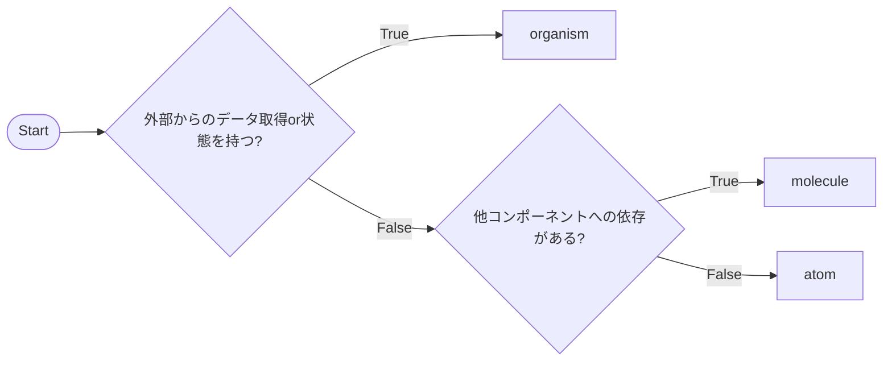
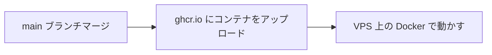

# usuyuki_blog_v2

うすゆきブログ v2

[](https://github.com/usuyuki/usuyuki_blog_v2/actions/workflows/label.yml)

[](https://github.com/usuyuki/usuyuki_blog_v2/actions/workflows/staticAnalysis.yml)

[](https://github.com/usuyuki/usuyuki_blog_v2/actions/workflows/lint.yml)

[](https://github.com/usuyuki/usuyuki_blog_v2/actions/workflows/deploy.yml)

# バックエンド

Ghost CMS 6（ヘッドレス）

# フロントエンド

Astro 7 + Tailwind CSS 4 + Svelte 5

## デザイン

エディトリアル(新聞・雑誌)調のデザイン。`wire/` のワイヤーフレーム3枚(トップ・記事一覧・記事詳細)が原典。

- デザイントークン: `--color-ink: #141414` / `--color-paper: #fff` / `--color-gray: #f4f3f0` / `--color-orange: #ff5c00`(`frontend/src/styles/tailwind.css` の `@theme` で定義)
- 2px罫線(`--bw`)・角丸なし・巨大英字タイポ(Webフォントなし、システムサンセリフ)
- 記事一覧は `/archive?year=2024&sort=oldest&page=2` 形式のSSRクエリパラメータ(年別・月別アーカイブURLは301でリダイレクト)
- 記事本文のコードブロックはSSR時に[Shiki](https://shiki.style/)でシンタックスハイライト、`mermaid`言語指定のコードブロックはクライアントサイドで[mermaid.js](https://mermaid.js.org/)により図として描画([ADR-00002](./adr/00002-mermaid-and-syntax-highlight.md)参照)

## 起動順序

astro が Ghost より先に起動すると記事を取得できないまま立ち上がるため、次の2段構えで防いでいます。

| 層 | 仕組み |
|---|---|
| Docker | `ghost` の `healthcheck` が Content API の応答を確認し、`astro` は `condition: service_healthy` で待機します |
| アプリ | Ghost の取得に失敗した回の記事一覧はキャッシュせず、次のリクエストで取得し直します |

## 記事ソース

Ghost 記事に加えて、外部サービスの記事をまとめて表示できます。

| サービス | 取得方式 | 設定キー |
|---------|---------|---------|
| Qiita | API v2（全記事・ページネーション対応） | `qiitaUserId` |
| Zenn | RSS | `rssUrl` |
| note | RSS | `rssUrl` |

`EXTERNAL_BLOGS` 環境変数で設定します：

```json
[
  {"name": "Qiita", "qiitaUserId": "username", "color": "#55c500"},
  {"name": "Zenn",  "rssUrl": "https://zenn.dev/username/feed", "color": "#3ea8ff"}
]
```

## 手動キャッシュクリア

記事詳細ページに `?debug=<CACHE_CLEAR_TOKEN>` を付けてアクセスすると、全インメモリキャッシュを消去します。トークンは `.env` の `CACHE_CLEAR_TOKEN` で指定します(compose経由でastroに渡る)。未設定なら機能は無効です。

```bash
openssl rand -hex 32  # トークン生成例
```

## 絵文字リアクションの保護

| 対策 | 内容 |
|------|------|
| slug検証 | `POST/GET /api/reactions/<slug>` は `isSlug()` を満たさないslugを400で拒否 |
| 記事存在確認 | POSTは公開済みGhost記事のslugのみ受け付け、それ以外は404(記事一覧が取得できないときは503) |
| レート制限 | POSTはIP単位で1分30回まで(超過は429)。IPはCloudflareの `CF-Connecting-IP` を優先 |
| NQL組み立て | `/reactions` はDB由来のslugを `isSlug()` で絞り込んでからGhostのフィルタを組み立てる |

## テスト

| 種別 | ツール | 実行方法 |
|------|--------|---------|
| ユニットテスト | Vitest | `docker compose exec astro pnpm test:run` |
| E2Eテスト | Playwright (chromium / firefox / webkit) | `docker compose exec -u root astro pnpm test:e2e` |

E2Eテストは `frontend/e2e/mock-ghost/` のモックGhost APIを使うため、実際のGhostバックエンドなしで動作します。CIでは `.github/workflows/e2e.yml` がPRごとに3ブラウザで表示崩れを検査します。

## コンポーネント



# デプロイ


